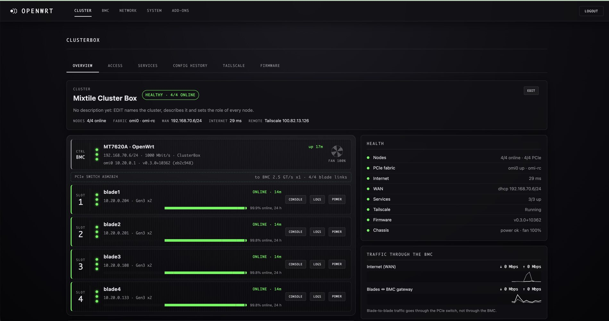

# Mixtile Cluster Box BMC firmware (OpenWrt, MT7620A)

[English](README.md) · [Русский](README.ru.md)

**An open OpenWrt firmware for the BMC of the Mixtile Cluster Box.** The
Cluster Box holds four **Mixtile Blade 3** compute boards; its control
board, the **BMC** (a MediaTek MT7620A), is on whenever the box has power,
whatever the blades do. This firmware replaces Mixtile's and turns the
BMC into the one place from which the whole box is run.

**Current release: [v0.4.3](https://github.com/roysbike/mixtile-clusterbox-mt7620a-openwrt/releases/tag/v0.4.3)**
(2026-10-28): OpenWrt 25.12.6 with the newest 25.12 packages, Linux 6.12;
the BMC firmware of OpenMIOP Stack v0.6.x and v0.7.0. Release notes:
[v0.4.3](release-notes/v0.4.3.md), [v0.4.2](release-notes/v0.4.2.md), [v0.4.1](release-notes/v0.4.1.md),
[v0.4.0](release-notes/v0.4.0.md) ·
[CHANGELOG.md](CHANGELOG.md).



*The start page of the web UI (v0.4.0): the cluster at the top, the box
from the front below it (the BMC, the PCIe switch, slots 1-4 from top to
bottom with their state, 24 h availability and CONSOLE, LOGS and POWER),
health and traffic beside it.*

## Contents

* [The OpenMIOP Stack](#the-openmiop-stack)
* [Features](#features)
* [Hardware](#hardware)
* [Where the BMC sits](#where-the-bmc-sits)
* [What is in the firmware](#what-is-in-the-firmware)
* [The web UI](#the-web-ui)
* [Install](#install)
* [Updates](#updates)
* [Recovery](#recovery)
* [Verify](#verify)
* [Known limitations](#known-limitations)
* [Build](#build)
* [Repository layout](#repository-layout)

## The OpenMIOP Stack

Mixtile ships the Cluster Box with its own BMC firmware and its own blade
network driver (MIOP). The **OpenMIOP Stack** is an independent, open
replacement made of three repositories that are released together:

| Repository | What it gives you | Stack v0.6.1 |
| --- | --- | --- |
| [pcie-ep-net](https://github.com/roysbike/pcie-ep-net) | the blade driver `openmiop-ep` (`omi0`), the BMC module `omi-rc`, the Blade 3 board modules | [v0.6.1](https://github.com/roysbike/pcie-ep-net/releases/tag/v0.6.1) |
| [mixtile-talos](https://github.com/roysbike/mixtile-talos) | Talos Linux (Kubernetes) for Blade 3 with openmiop built in | [v0.6.1](https://github.com/roysbike/mixtile-talos/releases/tag/v0.6.1) (Talos v1.14.4) |
| **mixtile-clusterbox-mt7620a-openwrt** (this one) | OpenWrt for the BMC: blade power and consoles, the BMC side of openmiop, the cluster's network edge, web UI, updates | [v0.4.3](https://github.com/roysbike/mixtile-clusterbox-mt7620a-openwrt/releases/tag/v0.4.3) (OpenWrt 25.12.6) |

**Versions.** The firmware has its own version numbers. The BMC side of
openmiop (`omi-rc` and the fallback helper `openmiop-rc`) is built into
the firmware from a pinned pcie-ep-net commit (`PKG_SOURCE_VERSION` in
`package/omi-rc` and `package/openmiop`). v0.4.0 to v0.4.2 pin pcie-ep-net v0.6.0
(its BMC code is the same as in v0.6.1 and v0.7.0, which only changed the blade side);
v0.4.3 pins `dd7a7a8`, v0.7.0 plus the `omi-rc` fan-in fix.
A new firmware release is needed only when the BMC side changes (`omi-rc`,
the helper, nodectl, the web UI or the OpenWrt base).

## Features

* **Power and consoles of the blades.** Switch each blade on and off,
  reset it, open its serial console in the browser, and read every boot
  of every blade later: the consoles are recorded to the BMC's storage.
* **The PCIe fabric.** The BMC is the PCIe root complex of the box. Its
  `omi-rc` module brings up **OpenMIOP**, Ethernet between the blades
  over the internal PCIe switch (`omi0`, 7.8-8.0 Gbit/s per flow between
  blades; that traffic stays in the switch and never touches the BMC).
* **The cluster's network edge.** The blades reach the LAN and the
  internet through the BMC (NAT, DHCP, DNS and NTP for the blades), and
  services of the cluster (Kubernetes API, ingress) are forwarded from
  the BMC's WAN address.
* **Remote access** to the box and the cluster: Tailscale, WireGuard,
  OpenVPN (server and outgoing connections), SSH, Teleport agent, and a
  web UI with a guard that rolls back access changes that would lock you
  out.
* **Watching the box:** which blades are up and for how long (24 h
  history), the fabric, the uplink, the forwarded services, the fans.
* **Its own updates:** the BMC checks GitHub Releases for new firmware,
  shows what changed and installs it from the web UI; the blades keep
  power and keep running meanwhile.

## Hardware

* **BMC:** MediaTek MT7620A (MIPS 24KEc, 580 MHz), 256 MB RAM, on-board
  eMMC (`mmcblk0`), U-Boot on SPI flash, a 1 Gbit/s WAN port, the fans
  and four CH343 USB serial adapters for the blade consoles. Board name
  `cluster-box-control-V120`, OpenWrt target `ramips/mt7620`. No radio,
  no removable card.
* **PCIe:** an ASMedia ASM2824 Gen3 switch with a Gen3 x2 link to each
  blade slot and a Gen1 x1 uplink to the BMC, which is the root complex.
* **Blades:** up to four Mixtile Blade 3 (Rockchip RK3588).

## Where the BMC sits

```
        LAN / Internet
              |
   WAN 1 Gbit/s (DHCP)          remote access: Tailscale, WireGuard, OpenVPN, Teleport
              |
  +--------------------------------------------------+
  |  BMC  MT7620A, OpenWrt (this firmware)           |
  |   web UI, SSH, nodectl (power, consoles, logs)   |
  |   NAT, DHCP, DNS, NTP for the blades, forwards   |
  |   omi-rc: omi0 10.20.0.1/24, the blades' gateway |
  +--------------------------------------------------+
        | PCIe Gen1 x1 (control + gateway)
   ASM2824 PCIe switch   (blade-to-blade traffic stays here)
     |         |         |         |      Gen3 x2 each
  slot 1    slot 2    slot 3    slot 4    Blade 3 (RK3588), omi0 10.20.0.x
```

The blades run the endpoint driver (`openmiop-ep`, ARM64; not part of
this firmware). The BMC runs `omi-rc` (push mode: the blades write their
state into BMC memory, the BMC never reads a blade). It finds the
endpoints (`1d87:4f4d`) behind the ASM2824, restores their BAR, command
and MPS settings, numbers them by switch slot, publishes the peer table
into every endpoint BAR and puts the BMC itself on `omi0` (10.20.0.1/24)
as the blades' gateway. `/etc/init.d/openmiop` loads the module and
starts the userspace helper `openmiop-rc` only if the module does not
load, or when `/etc/openmiop.use-helper` exists (blades older than
pcie-ep-net v0.3).

## What is in the firmware

| Package | Content |
| --- | --- |
| `kmod-omi-rc`, `openmiop` | the BMC side of OpenMIOP: `omi-rc.ko` (log: `dmesg \| grep omi0`), `/etc/init.d/openmiop`, the fallback helper `openmiop-rc` and `omi-peek`, from pcie-ep-net |
| `nodectl`, `luci-app-nodectl` | blade power, reset, serial consoles (browser terminal), console archive, PXE and flashing; LuCI **Cluster** menu |
| `clusterbox` | the BMC settings (`/etc/config/clusterbox`): management access with roll-back guard, WAN fallback address, DNS and NTP for the blades, persistent log, configuration history, node availability log, cluster description, firmware status; the backend of the web UI |
| `moci`, `moci-app-clusterbox` | the web UI (MoCI 0.2.0, patched for the box) with the ClusterBox pages; LuCI stays at `/cgi-bin/luci` |
| `mixtile-release` | `/etc/mixtile-release`: firmware version (git tag), commit, build date, repository, OpenWrt and kernel version, board, OpenMIOP protocol, update channel, generated by the build |
| `mixtile-update`, `luci-app-mixtile-update` | update check, download, verification and install from GitHub Releases, background check |
| `luci-app-teleport` | installs and runs a Teleport agent (`teleport-<version>-linux-mipsel.gz` from the firmware release) |
| Tailscale, WireGuard, OpenVPN | remote access, with pages in the web UI (NETWORK → TAILSCALE, WIREGUARD, OPENVPN) and in LuCI |

| v0.4.3 | |
| --- | --- |
| OpenWrt / kernel | 25.12.6, Linux 6.12.112 (ramips/mt7620), packages with `apk`; packages feed and `ca-certificates` at the `openwrt-25.12` branch of 2026-10-26 |
| OpenMIOP | `omi-rc` and `openmiop-rc` from pcie-ep-net `dd7a7a8` (v0.7.0 plus the fan-in fix; protocol v4; push mode, gateway pull, zero-copy; root port completion timeout off) |
| Works with blades on | pcie-ep-net v0.3.0 and later; gateway pull with v0.4.0, zero-copy with v0.5.0, checksum offload between blades with v0.6.0 |
| nodectl | 2.0-7 with console archive and probe; never reads the blades' PCIe config space |
| Teleport agent | 18.10.0 (release asset) |

## The web UI

Three pages, each setting in one place. Defaults: web UI on port 80, SSH
on 22, user `mixtile` (the web UI asks to change the factory password);
an update keeps the ports already in use.

| Page | Tabs |
| --- | --- |
| **CLUSTER** | the start page: the cluster, the box from the front, health, traffic |
| **NETWORK** | TOPOLOGY · INTERFACES (with the WAN fallback address) · FIREWALL (with the port forwards) · DHCP & DNS (DNS, DHCP and names for the blades on omi0) · ROUTES · DEVICES · TAILSCALE · WIREGUARD · OPENVPN · DIAGNOSTICS |
| **SYSTEM** | GENERAL (name, time zone, NTP for the blades, reboot) · ACCESS (web/SSH ports and zones, password) · FIRMWARE (updates from GitHub, manual upload) · BACKUP (with progress and the configuration history) · SOFTWARE (apk: installed, search, install, remove) · STARTUP · LOGS · SCHEDULED TASKS · SSH KEYS · STORAGE |

**CLUSTER**, the start page:

* On top, the cluster: its name and description and the role and note of
  every slot (**EDIT**; the BMC does not see Kubernetes, so the operator
  writes them), an overall state and the key facts (nodes online, fabric,
  WAN, internet, Tailscale).
* The box from the front: the BMC on top (power, WAN and PCIe switch
  LEDs, fan duty), the ASM2824 switch with its uplink, then slots 1-4
  from top to bottom. Every slot shows LEDs for power, PCIe link and the
  node answering on its check port, the name, role, address and link
  (Gen3 x2), the state and how long the node has been in it, the last
  24 hours as a bar, and CONSOLE, LOGS and POWER (shut down, reboot, cut
  power, power on).
* Beside it: health (nodes, fabric, internet, WAN, forwarded services
  checked every 30 s, Tailscale, firmware, chassis), traffic through the
  BMC over the last 5 minutes, the forwarded services and the BMC's load,
  memory and uptime.

The page asks the BMC every 5 s, changes only what changed and stops
while the browser tab is hidden.

**NETWORK → TOPOLOGY** draws the box's network as it is now: the
internet and the upstream router, the BMC (WAN address, traffic, port
forwards, firewall zones) and each network behind it with what is on it:
`omi0` with the four blades and the forwarded service addresses,
Tailscale, the OpenVPN server and its clients, outgoing OpenVPN and
WireGuard.

**NETWORK → OPENVPN:**

* *Server*: remote access to the BMC and to the blades' network
  10.20.0.0/24. **SET UP THE SERVER** asks for the address clients
  connect to, port, protocol and client subnet; **ADD CLIENT** makes a
  client and downloads its `.ovpn`; **DELETE** locks a client out. No
  certificate authority: the server and every client have their own
  self-signed EC certificate, each side pins the other's SHA-256
  fingerprint. Keys stay in `/etc/openvpn/cb/` and survive updates.
  Forward the port to the BMC on the upstream router.
* *Connections to other VPN servers*: upload an `.ovpn`; the BMC connects
  out with it. Directives that run programs (`up`, `script-security`,
  `plugin`, …) are refused.

**DHCP on omi0** is on by default (10.20.0.20-99; the blades, 10.20.0.205
and the MetalLB pool 210-219 stay static) and hands out the BMC as
gateway, DNS and NTP server.

**Console logs.** Each blade's serial console (CH343 USB UART,
1.5 Mbaud) is recorded by `nodectl consoled` to the BMC's eMMC, one file
per boot: `/overlay/log/nodectl/nodeN/YYYYmmdd-HHMMSS.log`, every line
with the BMC time. A new file starts on a power on or reset, on a U-Boot
or kernel boot banner, or when kernel timestamps go back. The oldest
boots are deleted above `console_archive_mb` (512) or
`console_archive_boots` (100) per blade (`/etc/config/nodectl`). **LOGS**
in the web UI reads, follows, searches and downloads them. Firmware
updates keep the archive.

**Availability.** `availwatch` checks every 20 s whether each blade is
powered, has its PCIe link and answers on its check port, and logs every
change to `/overlay/log/clusterbox/availability`.

## Install

Release assets:

| File | Purpose |
| --- | --- |
| `openmiop-<version>-clusterbox-bmc-openwrt-<openwrt>-mipsel-sysupgrade.bin` | the firmware (`<openwrt>` = `25.12.6` from v0.4.0, `23.05` up to v0.3.0), written by sysupgrade to the BMC's eMMC |
| `clusterbox-firmware.json` | board, target, version, commit, OpenMIOP protocol, image SHA-256 (read by `mixtile-update`) |
| `mixtile-update` | the update tool, for the first install from other firmware |
| `teleport-<version>-linux-mipsel.gz` (+ `.sha256`) | Teleport agent for `luci-app-teleport` |
| `SHA256SUMS`, `BUILD-INFO.txt` | checksums and build record |

There is no separate factory image for this board.

> [!WARNING]
> Installing reboots the BMC, and the BMC is the PCIe root complex: every
> blade link resets for ~150 s, and with it all traffic between the
> blades (the blades keep power). With DRBD check that every replica has
> `out-of-sync:0` first
> ([LINBIT/drbd#153](https://github.com/LINBIT/drbd/issues/153)), pause
> CloudNativePG's primary isolation check, and back up the configuration
> (`sysupgrade -b`, SYSTEM → BACKUP).

**From Mixtile's firmware or OpenWrt 23.05 (v0.3.0 and older).** OpenWrt
25.12 uses `apk` instead of `opkg` and a different network layout, so
treat it as a reinstall that keeps `/etc/config`:

1. Back up the configuration and note your port forwards and management
   ports.
2. Verify the image (`sha256sum -c --ignore-missing SHA256SUMS`) and
   flash it with LuCI *System → Backup / Flash Firmware*, keeping the
   settings. This is how the lab BMC went to 25.12.
   `sh mixtile-update install-local --yes <image>` over SSH should work the
   same and also cleans the overlay, but has not been tried from 23.05 yet.
3. After the first boot log in as `mixtile`, check NETWORK → FIREWALL (port
   forwards) and SYSTEM → ACCESS (ports), restore what is missing.

Packages installed by hand are not kept; install them again under
SYSTEM → SOFTWARE. On this board sysupgrade rewrites only kernel and
rootfs: files changed by hand in the overlay keep shadowing the new
firmware (check `ls /overlay/upper/usr/bin /overlay/upper/etc/init.d`);
`mixtile-update` removes them, LuCI does not.

## Updates

**Web UI.** The BMC looks for a new release itself (5 min after boot,
then every 12 h; only a check). A banner then offers it on every page
with the release notes; **UPDATE** downloads, verifies and installs it,
waits for the BMC and reloads the page. SYSTEM → FIRMWARE shows the
running firmware and the last check.

**SSH:**

```sh
mixtile-update status
mixtile-update check                 # newest release on the channel
mixtile-update download
mixtile-update verify                # board, target, version, OpenMIOP protocol, SHA-256
mixtile-update install --yes         # prunes the overlay, then sysupgrade
                                     # --background: detached, log in /tmp/mixtile-update/install.log
```

* Source: the GitHub Releases of the repository in `/etc/mixtile-release`
  (this one); override with `uci set mixtile-update.main.repository=<owner/repo>`.
* Channels: `rc` (release candidates and final releases) and `stable`
  (final only): `uci set mixtile-update.main.channel=stable; uci commit mixtile-update`.
* **UPDATE in the web UI of v0.4.1/v0.4.2 can fail** with
  `clusterbox.fw_install: ubus status 5` (it verifies for longer than
  rpcd waits); install over SSH then: `mixtile-update install --yes
  --background` (log in `/tmp/mixtile-update/install.log`). Fixed in the
  web UI of v0.4.3, so updates from v0.4.3 on work from the web UI.
* Nothing is installed automatically. Downgrades and reinstalls need
  `--allow-downgrade`; a release with a different OpenMIOP protocol needs
  `--allow-protocol-change` (upgrade the blades to match). Development
  builds (`vX.Y.Z-N-g<sha>`) are never offered a release.
* A release is accepted only if `clusterbox-firmware.json` names this
  board and target, `sysupgrade -T` accepts the image and its SHA-256
  matches `SHA256SUMS` and the manifest. If a usign key is in
  `/etc/mixtile-update/keys/`, `SHA256SUMS.sig` must verify too; releases
  are not signed yet.

| Kept on update | Replaced |
| --- | --- |
| everything `sysupgrade -l` lists (`/etc/config/*`, users, SSH host keys), plus `/etc/mixtile-update/`, `/etc/rc.d/`, `/root/.ssh/`, `/home/`, `/opt/`, the console archive and logs under `/overlay/log` | kernel and root filesystem; other files changed in the overlay; packages installed by hand |

## Recovery

* If an update fails before the reboot, nothing has been written and the
  old firmware keeps running.
* U-Boot, its environment and the factory data are on the SPI flash
  (`mtd0`-`mtd2`); kernel, rootfs and overlay are on `mmcblk0`.
  sysupgrade writes the image at sector 16 of `mmcblk0`; partition table
  and overlay (`mmcblk0p3`) stay.
* **If the BMC does not come back,** restore the factory firmware with
  the reset button: power the box off, hold the BMC's reset button, power
  on and keep holding it until the LED blinks, then release. The BMC
  comes up with Mixtile's factory firmware and settings; install the
  wanted release again from there. Done on the lab unit on 2026-10-14.
  The configuration is lost, so back it up before every update:

  ```sh
  sysupgrade -b /tmp/bmc-config.tar.gz   # then copy it off the BMC
  uci export > /tmp/bmc-uci.txt          # readable copy
  ```

  While the BMC is down the blades lose their LAN too.
* Blades keep power while the BMC is down or rebooting. Blades on
  pcie-ep-net v0.3+ reconnect to each other after ~12 s; the BMC
  (`omi0` 10.20.0.1, the blades' gateway) is back when `omi-rc` has
  loaded, ~150 s after power-on.

**Serial console of the BMC.** The controller board has a 3-pin UART
header (TX, RX, GND; 2.54 mm, not fitted: solder one in) next to a push
button and the RTC battery, see Mixtile's
[UART of Controller Board (PDF)](https://downloads.mixtile.com/blade3/file/UART%20of%20Controller%20Board.pdf).
Use a 3.3 V USB-UART adapter (TX to RX, RX to TX). Mixtile gives
57600 8N1; this firmware's kernel uses `console=ttyS0,115200`, so switch
the terminal to 115200 if the output turns to garbage after U-Boot:
`picocom -b 57600 /dev/ttyUSB0` (Ctrl-A Ctrl-B changes the speed).

## Verify

```sh
cat /etc/mixtile-release
dmesg | grep omi0                                 # "push mode", "node N active ... gateway pull, zero-copy"
nodectl status --all                              # every blade powered, LINK Gen3 x2
lspci -d 1d87:4f4d -vv | grep -E 'LnkSta|Region 0'   # reads the blades: never while one reboots
ip addr show omi0                                 # 10.20.0.1/24, mtu 9000
ping -c3 10.20.0.<blade>
```

If `omi-rc` cannot load, `/etc/init.d/openmiop` starts the helper
instead: `pgrep -l openmiop-rc; tail /tmp/openmiop-rc.log`.

## Known limitations

* **Gateway speed:** the BMC forwards between the blades and the LAN with
  its own CPU: ~220-245 Mbit/s on OpenWrt 25.12 (10-20 % below 23.05).
  Blade-to-blade traffic is not affected.
* **A BMC reboot resets the fabric** for ~150 s: every blade link and, on
  Blade 3, the M.2 NVMe (mixtile-talos recovers it). See the warning
  under [Install](#install).
* **Updates:** releases are not signed yet (checksums over HTTPS from
  GitHub); no A/B root filesystem, so a firmware that does not boot needs
  the factory restore.
* **Packages:** kernel modules from the OpenWrt feeds install only when
  they match the firmware's kernel.
* **Not tested yet:** `mixtile-update install` from OpenWrt 23.05; the
  OpenVPN server against real clients on the lab network.

## Build

GitHub Actions (`.github/workflows/clusterbox-firmware.yml`, self-hosted
runner) builds the firmware for pull requests to `v120` and for `v*`
tags, unpacks the image and checks its contents
(`scripts/clusterbox/verify-firmware.sh`), and for a tag publishes the
release with the Teleport agent. `.github/workflows/main.yml` is
Mixtile's original manual build. Locally:

```sh
./build.sh feeds_update feeds_install cluster-box-config
make defconfig
MIXTILE_FW_VERSION=$(git describe --tags --always) ./build.sh firmware
./scripts/clusterbox/collect-release.sh release extras
```

Feeds are pinned to commits in `feeds.conf.default`. The OpenMIOP
packages download pcie-ep-net at the commit in their `PKG_SOURCE_VERSION`.

## Repository layout

The tree is a full OpenWrt 25.12 source tree (`target/`, `package/`,
`tools/`, `toolchain/`, `include/`, …; see the
[OpenWrt developer guide](https://openwrt.org/docs/guide-developer/start)).
What is specific to the Cluster Box:

| Path | Content |
| --- | --- |
| `package/omi-rc/`, `package/openmiop/` | the BMC side of OpenMIOP, pinned to a pcie-ep-net commit |
| `package/nodectl/`, `package/luci-app-nodectl/` | blade power, consoles, console archive |
| `package/clusterbox/` | BMC settings, availability, web UI backend |
| `package/moci/`, `package/moci-app-clusterbox/` | the web UI |
| `package/mixtile-update/`, `package/luci-app-mixtile-update/`, `package/mixtile-release/` | updates and firmware identity |
| `package/luci-app-teleport/` | Teleport agent |
| `config/BoardConfig/cluster-box-config`, `build.sh` | the Cluster Box build configuration and build entry point |
| `other-files/` | files copied into the image as they are (`fstab`, `pci.ids`) |
| `scripts/clusterbox/`, `scripts/build-teleport-mipsel.sh` | release collection, image verification, Teleport agent build |
| `release-notes/` | release notes per version ([template](release-notes/TEMPLATE.md)) |

License: GPL-2.0, as OpenWrt ([COPYING](COPYING), [LICENSES/](LICENSES/)).
